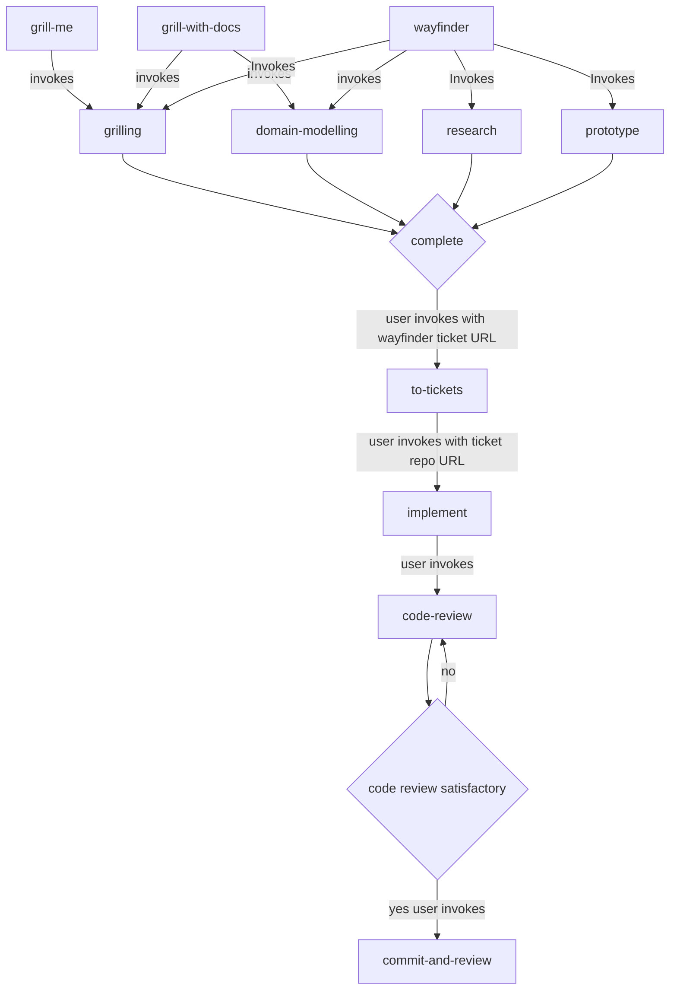
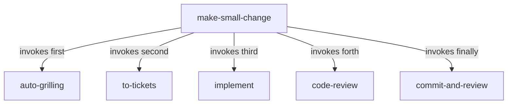
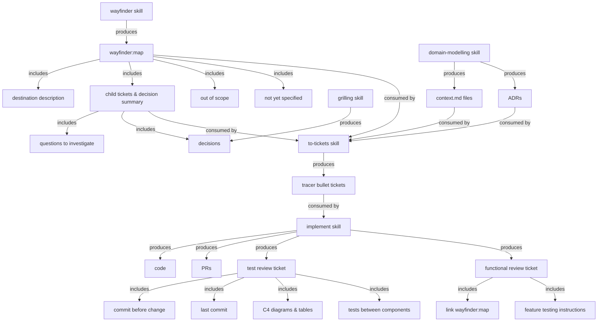

# Skill workflow

This shows how skills relate to each other for large and medium sized changes

This shows how  how skills interact the for make-small-change skill

The workflow therefore depends on the size of the change

## Large Change
You have a large feature or set of features with a lot of uncertainty about the requirements that may take multiple sessions to resolve

The flow is then
- /wayfinder {describe what you want to do}
    - this will build up the questions to iterate, perform research, create prototypes if necesary
    - if you need to walk away and come back, /wayfinder {continue with url-to-wayfinder:map-ticket}
- /to-tickets {wayfinder:map ticket url}
- /implement {ticket board or list URL}
- resolve human in the loop tickets and pull requests
- resolve human in the loop architecture and tests review ticket
- resolve human in the loop functional review ticket

## Medium change
if you think the change is small enough that you can resolve all open questions about requirements and design in a single session the the flow is as follows. 

Note this does not mean you have to complete implementation in a signle session, it just means you can start with grill-with-docs to get to implementation ticket generation in one session.

- /grill-with-docs {describe what you want to do}
- /to-tickets in the same session, the tickets will use everything in the context from the grilling session
- /implement {ticket board or list URL}
- resolve human in the loop tickets and pull requests
- resolve human in the loop architecture and tests review ticket
- resolve human in the loop functional review ticket

## Small change
The change is small enough that there is little risk getting the AI to go from a requirement to implementation in one shot.

It will still work through a similar process of grilling itself, reviewing any existing architecture decisions and using the implement skill to drive implementation with TDD.

However it will do this all autonomously unless it cannot reconcile a change to existing architecture decisions, then it will ask the user how to resolve that.

Because implementation is automated it is even more important to perform the user driven architecture and test and functionality reviews to ensure the result is what you want

- /make-small-change {describe what you want to do}
- resolve human in the loop tickets and pull requests
- resolve human in the loop architecture and tests review ticket
- resolve human in the loop functional review ticket

## Artifacts created

These is how the skills produce and consume artifacts

