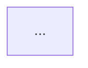
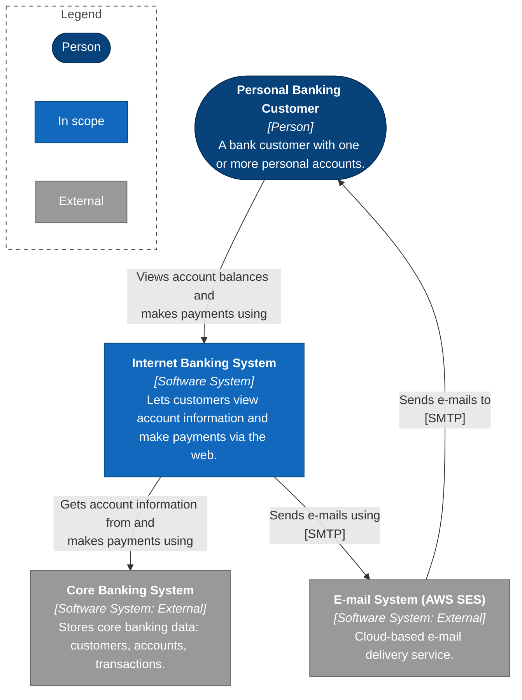
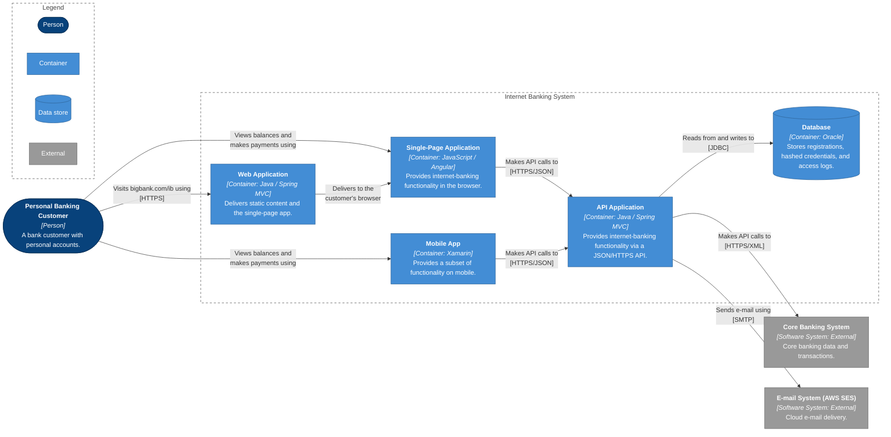
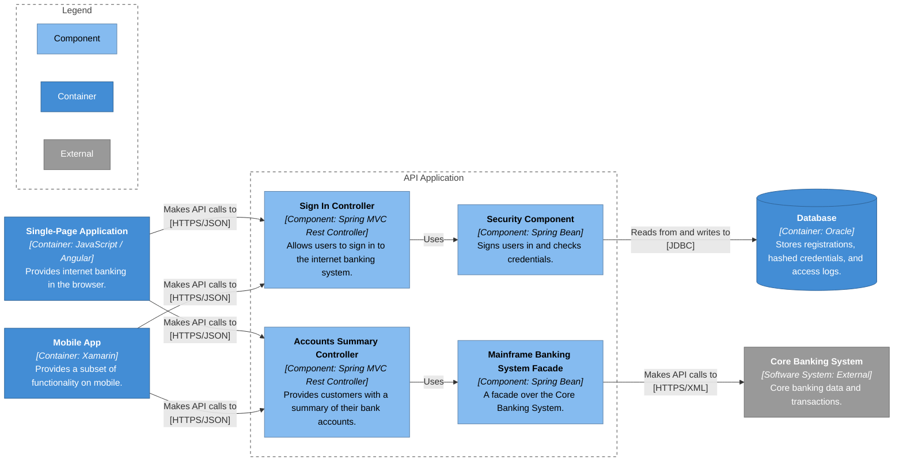
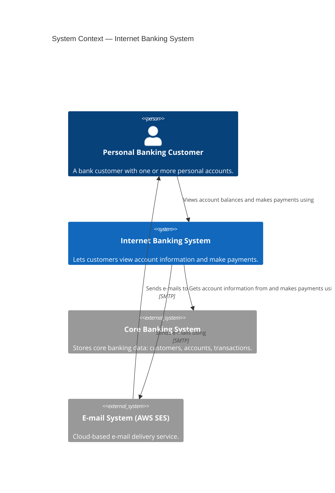
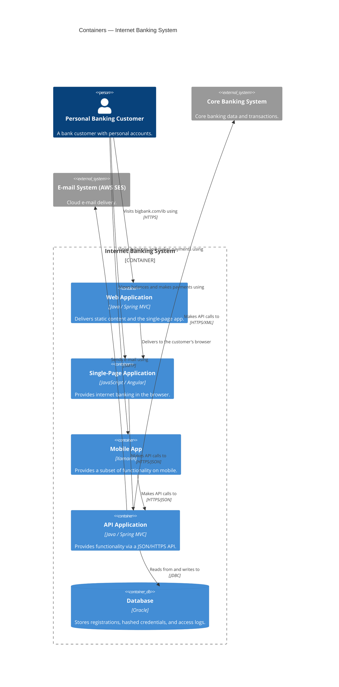
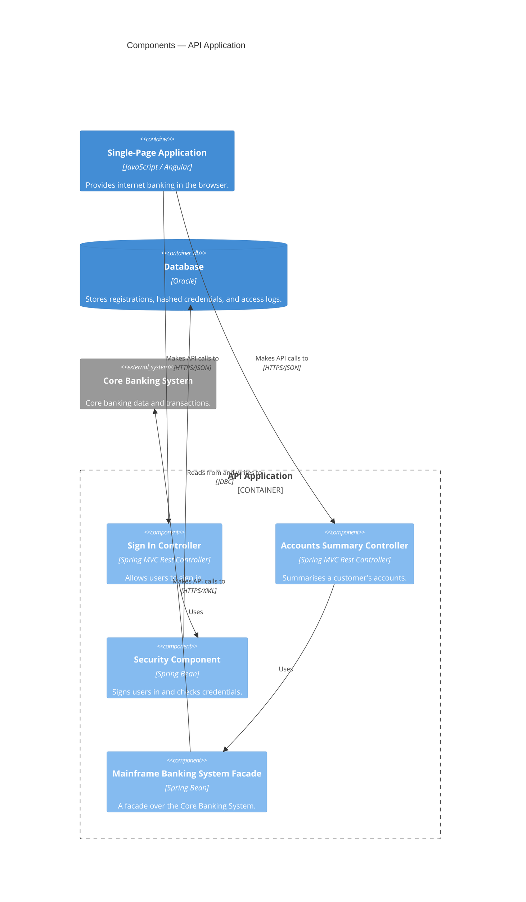

# C4-Diagram — Representing C4 Architecture in Mermaid

A reference for producing **Mermaid diagrams** of a software system's architecture at the three
most-used C4 levels: **System Context**, **Container**, and **Component**.

The output is a Markdown document whose diagrams render wherever Mermaid renders — GitHub, GitLab,
most docs sites, Obsidian, VS Code preview, an artifact page. Every element, every relationship, and
every legend that C4 asks for is expressed as **nodes, labelled directional edges, boundaries, and a
legend**.

Reference distilled from [c4model.com/diagrams](https://c4model.com/diagrams). C4 is created by
Simon Brown (CC BY 4.0).

> **Why a picture?** A C4 diagram encodes *elements* (boxes), *relationships* (labelled arrows), and
> a *legend*. Rendered, those three carry topology at a glance — what talks to what, and where the
> boundary of your responsibility sits. That's the one thing a table is genuinely worse at. Where the
> reader needs greppability and diffability instead, use the `c4-to-text` skill.

---

## The core idea

C4 is a hierarchy of zoom levels — "Google Maps for code". You zoom out to see the whole landscape,
then progressively zoom in. This document covers the three static-structure levels:

| Level | Diagram | Zoom | Scope | This doc's section |
|---|---|---|---|---|
| 1 | System Context | Widest | A single **software system** and its surroundings | [Level 1](#level-1--system-context) |
| 2 | Container | Inside one system | The **containers** (apps / data stores) within it | [Level 2](#level-2--container) |
| 3 | Component | Inside one container | The **components** inside a single container | [Level 3](#level-3--component) |

Prefer generating Component diagrams from code so they do not drift.

Each level maps onto the **same diagram shape**:

1. **Nodes** — the boxes: name, element type, technology (levels 2–3), and a short responsibility.
2. **Edges** — the arrows: directional, labelled with an active verb, annotated with a protocol.
3. **A boundary** — a subgraph marking what is in scope, so external things read as external.
4. **A legend** — the colour/shape key.

Everything below is a refinement of that shape per level, plus the conventions that keep the picture
unambiguous.

---

## Choosing a Mermaid dialect

Mermaid offers two ways to draw C4. **Pick one per document and stay consistent.**

| | `flowchart` + C4 styling **(default)** | Native `C4Context` / `C4Container` / `C4Component` |
|---|---|---|
| Stability | Stable, core Mermaid | Marked **experimental**; syntax may change between versions |
| Renderer support | Everywhere Mermaid works | Newer renderers only; older ones show a parse error |
| Layout control | Good — direction, subgraphs, edge direction | Limited — `UpdateLayoutConfig` and `Rel_U/D/L/R` only |
| Semantics | You encode C4 by convention | C4 vocabulary is built in |
| Effort | Slightly more boilerplate (`classDef`s) | Terser |

**Default to `flowchart`.** It renders reliably in more places and you can control layout, which is
most of what makes a diagram readable. The native dialect's layout is genuinely weak at the Container
level and above: `UpdateLayoutConfig` is advisory at best, boundary members tend to stack into a
single column, and long relationship labels overlap each other and the boundary title — with no
`direction` or declaration-order lever to fix it. Expect to accept whatever it gives you.

**Use native C4 syntax** when the reader explicitly asks for it, when the diagram will be consumed by
C4-aware tooling, or when you want the C4 vocabulary to be self-documenting in the source — and say
in the surrounding prose that it needs a recent Mermaid.

Never mix dialects within one document.

---

## The C4 palette

These are C4/Structurizr's default colours. Use them so the diagrams read as C4 to anyone who's seen
one before, and so **in-scope vs external is visible without reading a word**.

| Role | Fill | Stroke | Text | Shape |
|---|---|---|---|---|
| Person (in scope) | `#08427B` | `#052E56` | `#FFFFFF` | stadium `(["…"])` |
| Person (external) | `#686868` | `#4A4A4A` | `#FFFFFF` | stadium `(["…"])` |
| Software System (in scope) | `#1168BD` | `#0B4884` | `#FFFFFF` | rectangle `["…"]` |
| Software System (external) | `#999999` | `#6B6B6B` | `#FFFFFF` | rectangle `["…"]` |
| Container | `#438DD5` | `#2E6295` | `#FFFFFF` | rectangle `["…"]` |
| Container / Component — database | as above | as above | as above | cylinder `[("…")]` |
| Container / Component — queue | as above | as above | as above | subroutine `[["…"]]` |
| Component | `#85BBF0` | `#5D82A8` | `#000000` | rectangle `["…"]` |
| Boundary | none | `#444444`, dashed | `#444444` | `subgraph` |

Declare them once per diagram as `classDef`s:

```
classDef person     fill:#08427B,stroke:#052E56,color:#FFFFFF
classDef personExt  fill:#686868,stroke:#4A4A4A,color:#FFFFFF
classDef system     fill:#1168BD,stroke:#0B4884,color:#FFFFFF
classDef systemExt  fill:#999999,stroke:#6B6B6B,color:#FFFFFF
classDef container  fill:#438DD5,stroke:#2E6295,color:#FFFFFF
classDef component  fill:#85BBF0,stroke:#5D82A8,color:#000000
```

**Explicit fills are deliberate** — they survive light and dark themes identically, whereas
theme-derived colours flip and can leave text unreadable. The one thing that does *not* survive is
the subgraph title colour, so set it explicitly with `style <id> ...,color:#444444`.

---

## Node and edge conventions

### Node ids

Short, lowercase, no spaces, stable across levels (`api`, `db`, `spa`, `customer`). The same real
element keeps the same id in every diagram in the document — that's what lets a reader track it
across zoom levels.

### Node labels

Three lines, in this order — this is exactly what a well-drawn C4 box carries:

```
<b>Name</b><br/><i>[Type: Technology]</i><br/>One-line responsibility.
```

- **Level 1** omits technology: `<i>[Software System]</i>`, `<i>[Person]</i>`.
- **Levels 2–3** include it: `<i>[Container: Java / Spring MVC]</i>`, `<i>[Component: Spring Bean]</i>`.
- External elements say so: `<i>[Software System: External]</i>`.
- Keep the responsibility to one short sentence. If it needs two, it belongs in the prose around the
  diagram.

`<br/>` is safe everywhere. `<b>` / `<i>` need Mermaid's HTML labels, which are **on by default** but
are disabled in some hardened embeds — if the target renderer is unknown or strict, drop the tags and
keep the `<br/>`-separated three-line structure.

### Edges

```
from -->|"Active verb phrase<br/>[Protocol]"| to
```

- **Direction is the arrow.** Never draw a bare line (`---`). If two elements genuinely talk both
  ways, use `<-->` with a label that reads correctly in both directions, or two separate edges.
- **Label reads as English:** *From + label + To*. "Makes API calls to", "Reads from and writes to",
  "Sends e-mails using" — not "connects to", not "uses" where a real verb exists.
- **Protocol on its own line** in square brackets where it matters: `[HTTPS/JSON]`, `[gRPC]`,
  `[JDBC]`, `[SMTP]`, `[AMQP]`. Omit the line entirely when it doesn't — an empty `[—]` is noise.
- **Always quote the label.** Unquoted edge labels break on `/`, `(`, `[`, `:` and `,`.

### Boundaries

Wrap the in-scope system (Level 2) or container (Level 3) in a `subgraph`. Everything outside the
subgraph is, visually and semantically, someone else's. Level 1 needs no boundary — the single blue
system box *is* the scope marker.

```
subgraph ibs["Internet Banking System"]
    direction TB
    ...
end
style ibs fill:none,stroke:#444444,stroke-dasharray:5 5,color:#444444
```

Nested boundaries (enterprise → system → container) are legal but rarely earn their cost; two levels
of nesting is the practical ceiling before layout degrades.

### Legend

A disconnected `subgraph legend[...]` with one node per element type used. It renders off to one side
and costs a handful of lines. Include it — the colour coding is not self-evident, and C4 asks every
diagram to carry a key.

### Layout and size

- **`flowchart TB` for small diagrams (roughly ≤6 nodes), `flowchart LR` for everything else.** This
  is not a style preference — see the fan-out rule below. Combine an outer `LR` with `direction TB`
  *inside* the boundary subgraph: the request path reads left-to-right while the boundary's internals
  stack sensibly.
- **The fan-out rule: when one node has 3+ outgoing edges, use `LR`.** In `TB`, edges fanning out
  from a single node converge into a narrow band and their labels **overlap into unreadable mush** —
  and Mermaid gives you no way to nudge them apart. The same diagram in `LR` spaces those labels down
  the left edge cleanly. This bites hardest on Container and Component views, where a user or a
  caller typically talks to several things at once. If you must stay in `TB`, cut the colliding
  labels to a few characters.
- Order node declarations along the flow you want — Mermaid's layout follows declaration order more
  than you'd expect.
- **Keep it under ~20 nodes.** Past that a C4 diagram stops communicating. Split by boundary, or drop
  to the next level down.
- **Look at the rendered result, not just the source.** Overlapping labels and crossing arrows are
  invisible in the Mermaid text and obvious in the picture.

---

## Recommended document skeleton

```markdown
# Architecture — <System Name> (C4, Mermaid)

<1–3 sentence summary of what the system is and does.>

## Level 1 — System Context: <System Name>

<1–2 sentences: what the reader should take from this diagram.>



## Level 2 — Containers: <System Name>

<1–2 sentences.>


## Level 3 — Components: <Container Name>   (repeat per container that warrants it)

<1–2 sentences.>


## Notes

<prose: anything the diagrams can't carry — assumptions, gaps, deployment concerns deferred.>
```

---

## Level 1 — System Context

**Scope:** a single software system.
**Primary element:** the software system in scope.
**Supporting elements:** the people (users, actors, roles, personas) and other software systems it
interacts with — these external systems are typically outside your control.
**Audience:** everybody, technical and non-technical, inside and outside the team.

Communicate: what the system is and broadly does, who uses it, and how it fits the surrounding system
landscape. Deliberately omit technology and internal detail — **no technology in node labels, and
protocols on edges only where they genuinely aid shared understanding.**

### Worked example — Internet Banking System (Context)



---

## Level 2 — Container

**Scope:** the single software system in scope, now opened up.
**Primary elements:** the **containers** inside it, drawn inside a system boundary.
**Supporting elements:** the people and external systems directly connected to those containers
(carried over from Level 1, keeping the same node ids).
**Audience:** technical people — architects, developers, operations/support.

> **A "container" in C4 is not a Docker container.** It is a separately runnable or deployable unit
> that executes code or stores data — something that must be running for the system to work.
> Examples: a server-side web app, a client-side SPA, a mobile app, a desktop app, a serverless
> function or batch job, a database schema, a file system or object store (e.g. an S3 bucket), a
> shell script.

Communicate: the high-level shape of the system and how responsibilities are distributed, the major
**technology choices** (annotate every container), and how containers **communicate** (protocol on
every inter-container edge). **Exclude deployment** — clustering, load balancers, replication,
failover, and scaling belong in a separate deployment view because they vary per environment.

### Worked example — Internet Banking System (Containers)



---

## Level 3 — Component

**Scope:** a **single container** in scope, drawn as the boundary.
**Primary elements:** the **components** inside that container — their responsibilities and
implementation detail.
**Supporting elements:** the other containers (in the same system) plus the people and external
systems directly connected to these components — drawn outside the boundary in their own colours.
**Audience:** software architects and developers.
Prefer **generating it from the codebase** — the component-to-code mapping drifts stale faster than
any other level when maintained by hand.

> A **component** is a grouping of related functionality behind a well-defined interface. Components
> are **not** separately deployable — they run inside a container.

Communicate: how the container decomposes into components, what each is responsible for, the
technology / implementation behind each, and how they collaborate. Include both
**component-to-component** edges inside the boundary and **component-to-outside** edges.

Because you may document more than one container this way, **repeat the diagram once per container**,
each under a heading naming the container in scope.

### Worked example — API Application container (Components)



---

## Native C4 syntax (alternative dialect)

Use only when the reader asks for it or C4-aware tooling will consume it. It is **experimental** in
Mermaid — note that alongside the diagram so nobody is surprised by a parse error on an older
renderer. No `classDef`s are needed: the C4 palette is built in.

**Element macros:** `Person`, `Person_Ext`, `System`, `SystemDb`, `SystemQueue`, `System_Ext`,
`Container`, `ContainerDb`, `ContainerQueue`, `Container_Ext`, `Component`, `ComponentDb`,
`ComponentQueue`, `Component_Ext`.
**Boundaries:** `Enterprise_Boundary(id, label)`, `System_Boundary`, `Container_Boundary`,
`Boundary(id, label, type)` — each takes a `{ … }` block.
**Relationships:** `Rel(from, to, label, techn?)`, `BiRel`, and direction-forcing
`Rel_U` / `Rel_D` / `Rel_L` / `Rel_R`.
**Layout:** `UpdateLayoutConfig($c4ShapeInRow="3", $c4BoundaryInRow="1")`,
`UpdateRelStyle(from, to, $offsetX, $offsetY)`, `UpdateElementStyle(id, $bgColor, $fontColor, $borderColor)`.

Note the argument order per level: `Container(id, label, technology, description)` — technology comes
*before* description, and `System(id, label, description)` has no technology slot at all.







---

## Syntax traps that break rendering

A diagram that doesn't parse is worse than no diagram. Check every block for these before finishing:

- **Unquoted labels.** Always `id["…"]` and `-->|"…"|`. Bare text breaks on `(`, `[`, `/`, `:`, `,`
  and `#`. This is by far the most common failure.
- **Quotes inside labels.** Don't nest `"` — use `&quot;` or rephrase.
- **`end` as a word.** A node id or label starting with `end` collides with the subgraph terminator;
  capitalise or rename.
- **Undefined ids in edges.** An edge to a node never declared silently creates an empty box. Every
  id in an edge must appear in a node declaration.
- **Node declared inside the wrong subgraph.** Mermaid binds a node to the subgraph where it is
  *first mentioned* — declare boundary members inside the `subgraph`, and everything else before it.
- **`class` before `classDef`.** Declare all `classDef`s, then apply with `class a,b,c name` — no
  spaces after the commas in the id list.
- **Markdown fence collision.** The fence is ```` ```mermaid ````; make sure nothing inside the block
  opens a nested fence.
- **Native C4 argument order.** `Container(id, label, technology, description)` — swapping the last
  two silently produces a wrong-looking box, not an error.

---

## Quality checklist

Before considering a C4 Mermaid document done:

- [ ] Every diagram is titled with its **level and the thing in scope**.
- [ ] **One dialect throughout** — `flowchart` or native C4, not both.
- [ ] Every node carries **name, type, and one-line responsibility**; containers and components also
      carry a **technology**.
- [ ] **In-scope vs external is visible without reading** — colour plus a boundary subgraph at
      Levels 2 and 3.
- [ ] Every edge is **directional**, labelled with an **active verb** that reads as English in the
      order *From → label → To*, and annotated with a **protocol where it matters**.
- [ ] A **legend** defines the shapes and colours used.
- [ ] Detail sits at the **right altitude** per level (no technology in Context; no deployment in
      Container).
- [ ] Each diagram is **under ~20 nodes** and doesn't rely on a single crossing arrow to be understood.
- [ ] Any node with **3+ outgoing edges** is in an `LR` diagram, or its labels are short enough not to
      collide — checked against the **rendered** picture, not the source.
- [ ] Node **ids are consistent across levels** for the same real element.
- [ ] Every block was **re-read for the syntax traps above** — quoted labels, defined ids, correct
      subgraph membership.
- [ ] Only the **levels that add value** are included; Component views are scoped
      one-container-per-diagram and ideally generated from code.

---

*Local reference for the `c4-diagram` skill. Definitions and guidance summarised from c4model.com
(C4 model by Simon Brown, CC BY 4.0). The Internet Banking System example is C4's canonical example,
reused here across levels and shared with the `c4-to-text` skill. Verify Mermaid syntax against the
current Mermaid docs — the native C4 dialect is explicitly experimental.*
